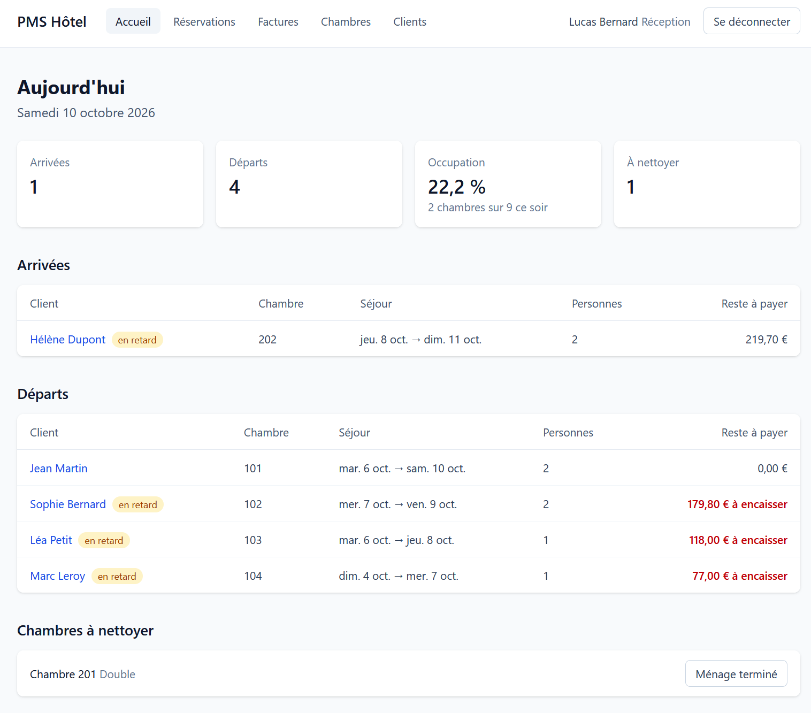
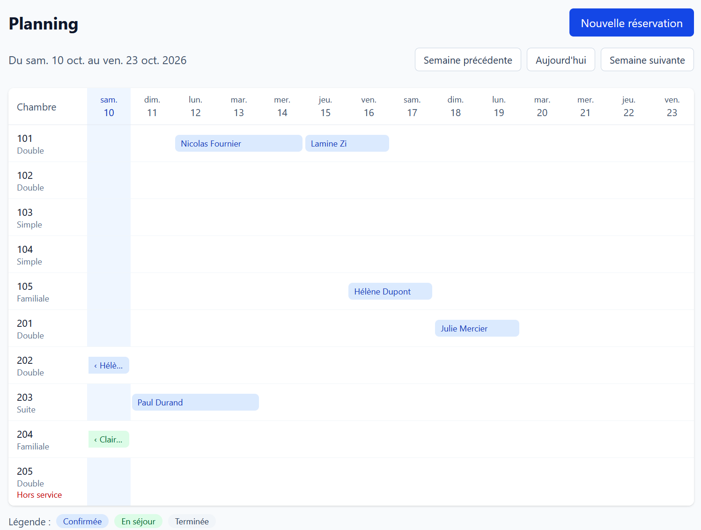
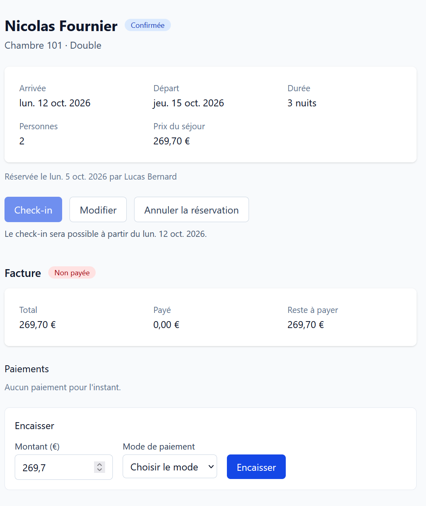
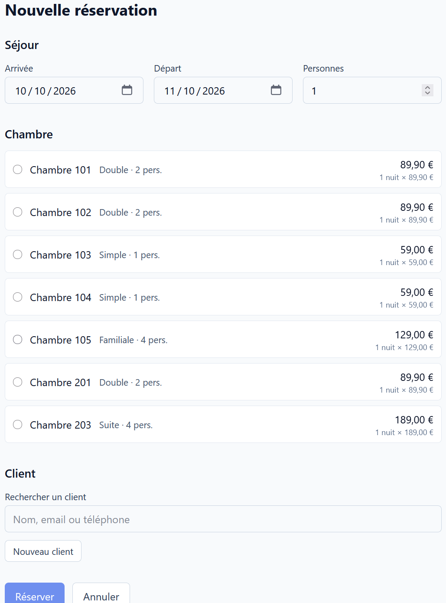
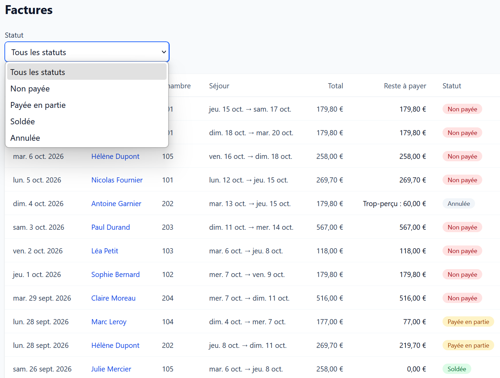
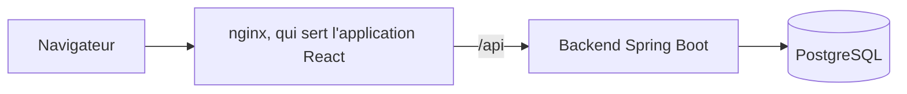

# PMS Hôtel

[](LICENSE)

Un logiciel de gestion hôtelière (PMS) pour un petit hôtel indépendant : réservations, chambres, clients, facturation et tableau de bord du jour, dans une seule application web.



## Fonctionnalités

- **Planning des chambres** : deux semaines de séjours, une ligne par chambre. Une case libre ouvre la réservation, avec la chambre et la date déjà choisies.
- **Réservation avec disponibilité en direct** : seules les chambres libres et assez grandes sont proposées, avec le prix du séjour. Le client se cherche par son nom, ou se crée sur place. La double réservation est impossible, et c'est la base de données qui le garantit.
- **Fiche de réservation** : check-in, check-out, annulation et modification, y compris la prolongation ou le départ anticipé d'un séjour en cours.
- **Facturation** : la facture naît avec la réservation et suit son prix. Les encaissements peuvent être partiels (espèces, carte, virement), et le check-out attend une facture soldée.
- **Tableau de bord du jour** : arrivées et départs à faire, retards compris, taux d'occupation de la nuit, chambres à nettoyer.
- **Chambres et clients** : statut physique des chambres (prête, occupée, à nettoyer, hors service), types et tarifs gérés par l'administration, recherche de clients insensible aux accents.
- **Deux rôles**, réception et administration, avec une authentification par jeton JWT.

| Planning | Fiche de réservation |
|---|---|
|  |  |
| **Nouvelle réservation** | **Factures** |
|  |  |

## Démarrer

Il suffit de Docker, avec Compose :

```bash
cp .env.example .env
docker compose up --build
```

L'application s'ouvre sur http://localhost:3000, avec des données de démonstration datées du jour : arrivées, départs, séjours en cours et factures dans tous les statuts.

| Rôle | Email | Mot de passe |
|---|---|---|
| Réception | `reception@pms.local` | `Reception123!` |
| Administration | `admin@pms.local` | `Admin123!` |

La documentation de l'API (Swagger UI) est sur http://localhost:3000/swagger-ui.html.

`.env.example` contient un secret JWT de démonstration, public, qui ne convient qu'à la démo locale. Si les ports 3000 ou 5432 sont déjà pris, il suffit de changer `FRONT_PORT` ou `POSTGRES_PORT` dans `.env`.

## Stack technique

| Domaine | Outils |
|---|---|
| Backend | Java 21, Spring Boot 4.1 (Web MVC, Data JPA, Security, Validation), PostgreSQL 16, Flyway, springdoc-openapi |
| Frontend | React 19, TypeScript 6, Vite 8, Tailwind CSS 4, React Router 8 |
| Tests | JUnit 5, Mockito, Testcontainers, ArchUnit ; Vitest, Testing Library |
| Qualité | Spring Java Format, Checkstyle ; ESLint, Prettier |
| Livraison | Docker Compose, nginx, GitHub Actions |

## Architecture



- **Le backend est organisé par domaine métier** : authentification, chambres, clients, réservations, facturation, tableau de bord. Chaque domaine regroupe son contrôleur, ses services, ses entités et ses DTO. Un test d'architecture (ArchUnit) vérifie à chaque build qu'aucun domaine ne dépend d'un autre en boucle.
- **Le frontend est organisé par fonctionnalité**, avec un client HTTP central, des hooks de lecture et d'envoi partagés, et des composants communs.
- **Le front et l'API partagent une seule origine.** nginx sert l'application et relaie `/api` au backend : il n'y a donc aucune autorisation cross-origin à ouvrir. Une `Content-Security-Policy` stricte n'autorise que les scripts du site lui-même.

Quelques règles métier qui structurent le code :

- le check-in n'est possible que pendant le séjour prévu, sur une chambre prête ; « aujourd'hui » est la date de l'hôtel (Europe/Paris), pas celle du serveur ;
- pendant un séjour, seule la date de départ peut changer ; chaque modification revérifie la disponibilité et recalcule le prix ;
- le check-out exige une facture soldée, et libère la chambre, qui passe à nettoyer ;
- une réservation annulée annule sa facture, et ses paiements deviennent un trop-perçu à rembourser.

### Décisions d'architecture

Chaque décision importante est expliquée dans [`docs/adr`](docs/adr/README.md) : son contexte, la décision, ses conséquences et les alternatives écartées.

| ADR | Décision |
|---|---|
| [0001](docs/adr/0001-organisation-par-feature.md) | Backend organisé par feature plutôt que par couche technique |
| [0002](docs/adr/0002-jwt-sans-refresh-token.md) | JWT sans refresh token, valable le temps d'une vacation |
| [0003](docs/adr/0003-identifiants-uuid.md) | Identifiants UUID plutôt qu'auto-incrémentés |
| [0004](docs/adr/0004-prix-nuits-fois-tarif.md) | Prix d'un séjour : nuits × tarif du type de chambre |
| [0005](docs/adr/0005-validation-jwt-resource-server.md) | Validation des JWT par le Resource Server de Spring Security |
| [0006](docs/adr/0006-double-reservation-contrainte-exclusion.md) | Double réservation impossible, garantie par une contrainte d'exclusion PostgreSQL |
| [0007](docs/adr/0007-facturation-inversion-de-dependance.md) | Facturation découplée des réservations par inversion de dépendance |
| [0008](docs/adr/0008-jeton-front-localstorage.md) | Jeton de connexion conservé dans le localStorage, risques compris |

## Développement

Il faut Java 21, Node 24 (la version exacte est dans `frontend/.nvmrc`) et Docker.

```bash
# La base de données seule
docker compose up -d postgres

# Le backend, sur http://localhost:8080
# (ajouter -Dspring-boot.run.profiles=demo pour les données de démonstration)
cd backend && ./mvnw spring-boot:run

# Le frontend, sur http://localhost:5173 ; il relaie /api au backend
cd frontend && npm ci && npm run dev
```

## Tests et qualité

```bash
# Formatage, Checkstyle, tests unitaires et d'intégration, test d'architecture
cd backend && ./mvnw verify

# Lint, formatage, tests et build
cd frontend && npm run lint && npm run format:check && npm test && npm run build
```

- Les tests d'intégration tournent sur un vrai PostgreSQL (Testcontainers), sans transaction englobante, pour se placer dans les conditions réelles de chargement des données.
- Les règles de date reposent sur une horloge injectée : elles se testent autour de minuit, et aux bornes de chaque règle.
- Côté front, les pages se testent dans le vrai routeur, avec un faux `fetch` qui garde la trace des requêtes. Les tests tournent à l'heure de Paris, ce qui rend visibles les erreurs de fuseau sur les dates.
- La CI (GitHub Actions) relance tout à chaque push et à chaque pull request.

## Démarche

Sur ce projet Mon objectif dépassait le code : apprendre comment un produit full stack doit être livré, de la façon la plus propre possible.

J'ai fait la conception de l'application : le périmètre du MVP, le modèle de données, les règles métier. Avec l'implémentation avec Spring Boot et React.

Les tests et la qualité du code à part Junit m'étaient en revanche inconnus : Mockito, Testcontainers et ArchUnit côté backend, Vitest et Testing Library côté front, le formatage et les règles de qualité automatiques, la CI. Je les ai mis en place avec Claude Code, qui m'a fait découvrir ce que chacun apporte et comment s'en servir. 

## Licence

[MIT](LICENSE)
